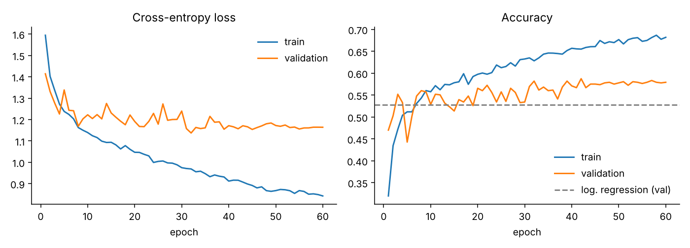
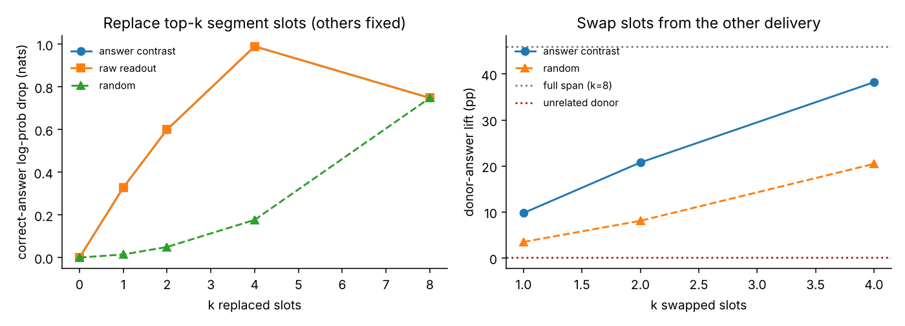

# Emotion Dynamics Lab — HW2: Make Your Application Learn

DS7400 Deep Learning (Prof. Baek), Homework 2. Builds on the Homework 1 speech-emotion viewer
([HW1 repo](https://github.com/Georg11a/deep-learning-assignments)) by adding a neural network that
**learns from speech and predicts the intended emotion of an utterance**, wired end-to-end into the web app:

```
User → choose / import a clip → React app → HTTP → Python server → PyTorch SegmentMLP → probabilities + per-segment evidence → React app
```

Prediction, interactive training (+10) and the live training monitor (+10) all run from the GUI —
no notebook or manual script is needed once the server is running.

## Results at a glance

Held-out **test speakers** (18 actors, 1,475 clips; speakers 1001/1002 shown in the app are in the test set):

| Model | Test accuracy | Macro-F1 |
|---|---|---|
| **SegmentMLP** (this work; 1 hidden layer, SGD) | **54.8%** (5 seeds: 54.6 ± 0.5) | 0.543 |
| Logistic regression on the same 8-segment features (C tuned on validation) | 52.6% | 0.520 |
| Logistic regression on utterance-mean features | 48.3% | 0.475 |
| Chance (6 classes) | 16.7% | — |

Every seed beats the strongest shallow benchmark. Hyperparameters were chosen on the validation speakers only.
Anger, sadness and neutral are recognised best; fear and happiness are most often confused (see the
confusion matrix in the app or `model/metrics.json`).



## The application

* **Data type:** speech audio (acted English sentences, CREMA-D) with transcripts, intended-emotion labels,
  and listener annotations.
* **Workspace tab (HW1 + new panel 06 / Model prediction):** browse, play, zoom the waveform and spectrum,
  compare deliveries of the same sentence, add context, annotate. Panel 06 shows the model's six class
  probabilities next to the dataset label (when revealed) and *your* annotation, plus an
  **evidence strip**: how strongly each of the 8 time segments supports the predicted answer
  (click a segment to jump the audio there). Imported local audio files are sent to the model too.
* **Evidence probe (inside panel 06):** replace the top-k segments with a training-average segment, or swap
  chosen segments with another delivery of the same sentence, and watch the prediction change.
* **Model & training tab (optional challenges):** choose learning rate, epochs, hidden units, number of hidden
  layers, activation, dropout and input features (MFCC + prosody vs. MFCC only); start/stop training and
  watch **live** training/validation loss and accuracy. When a run finishes it shows train/val/test accuracy,
  the comparison with the shallow benchmarks and a test confusion matrix; one click makes the new run the
  model used for predictions (or reverts to the default).
* **Pilot study panel:** results of the evidence analysis below.

## Model

**SegmentMLP** (`training/model.py`) — deliberately small and explainable:

1. Each utterance is trimmed of silence and cut into **K = 8 equal time segments**.
2. Every segment is summarised by 88 acoustic features (`training/features.py`): mean/std of 20 MFCCs and
   their deltas (80), plus prosody — log-F0 mean, std, range and voiced fraction (YIN), log-energy mean/std,
   spectral centroid and zero-crossing rate. Pitch is added explicitly because MFCCs carry little F0 information.
3. A **shared MLP encoder** (88 → 128 hidden units, ReLU, dropout → 64-d "latent slot", ReLU) is applied to every segment.
4. The 8 latent slots are concatenated and a linear layer outputs 6 class logits
   (anger, disgust, fear, happiness, neutral, sadness).

Because the output layer is linear in the concatenated slots, each class logit splits exactly into
per-segment contributions `r_t(y) = W[y, slot t] · z_t`; the evidence strip shows the positive part of
`r_t(top class) − mean r_t(other classes)`.

**Why this model:** it fits the assignment's "small MLP" brief, trains in about 20 s on a laptop CPU (so training
can be interactive in the GUI), and its segment slots give positions to inspect — the analogue of the latent
tokens studied in the paper used for the pilot below.

**Training** (`training/train.py`) is an explicit loop: initialise → forward pass → cross-entropy loss →
`loss.backward()` (backpropagation computes all parameter gradients) → `SGD(momentum=0.9).step()` → repeat.
Settings: weight decay 5e-3, dropout 0.5, batch 64, learning rate 0.02 with cosine decay, 60 epochs. The checkpoint
with the best validation accuracy (epoch 42) is kept and evaluated once on the test speakers
(train 74.7% / validation 58.7% / test 54.8%).

**Data split:** by speaker (actor) — 64 train / 9 validation / 18 test actors (5,235 / 732 / 1,475 clips) — so the
model is always evaluated on unseen voices. Inputs are z-scored with training-set statistics.

## Pilot study: does the model use the right evidence?

Adapted from *Rethinking Latent Visual Reasoning: Grounding Latent Reasoning in Visual Evidence*
(Xiao et al., 2026, arXiv:2609.34563). That paper shows that latent reasoning tokens in multimodal LLMs can
reach correct answers while responding only weakly to input changes that *should* change the answer
(a "latent evidence-credit gap"), measured with paired counterfactuals and fixed-context interventions on
latent positions. We borrow the **diagnostics** — not the paper's causal explanation, which is specific to
GRPO training of LLMs — and apply them to SegmentMLP's 8 latent segment slots. CREMA-D supplies natural
counterfactuals: the same actor speaking the same sentence with different emotions.
Code: `training/probe.py`; results: `model/probe_results.json`, `model/probe_interventions.png`.

**1. Paired counterfactuals** (paper App. J.1). *C pairs* differ only in emotion (prediction should change);
*U pairs* differ only in sentence (prediction should not change). 2,965 C pairs and 5,930 U pairs from the test speakers.

| Measure | MFCC + prosody | MFCC only |
|---|---|---|
| Strict correct flip on C (both clips right) ↑ | 31.0% | 28.1% |
| False flip on U (prediction changes, emotion didn't) ↓ | 48.8% | 49.8% |
| Mean latent cosine distance, C / U pairs | 0.43 / 0.34 | 0.40 / 0.32 |

**Control (important).** These flip rates are *exactly* what a 55%-accurate classifier with independent errors
would produce: shuffling the model's predictions among clips of the same speaker and emotion gives a false flip of
48.8% and a strict correct flip of 30.7% — identical to the observed values. So the flip rates by themselves show
only that the model is imperfect, **not** that it ignores emotional delivery. The more informative evidence is in
the representation:

| Latent-slot analysis (MFCC + prosody model, test speakers) | Value |
|---|---|
| Cosine distance: same speaker+sentence, different emotion (C) | 0.43 |
| Cosine distance: same speaker+emotion, different sentence (U) | 0.34 |
| Cosine distance: different speaker, same sentence+emotion | 0.41 |
| Linear probe from latents → emotion / sentence / speaker (chance) | 55% (17%) / 55% (9%) / 54% (6%) |

Changing the speaker moves the latent slots almost as much as changing the emotion, and the slots encode sentence
and speaker identity about as decodably as emotion: the learned representation is entangled with *who* speaks and
*what* is said, not only *how*. This is a known issue in speech emotion recognition (see related work below).

**2. Perturbations.** Share of test predictions that change:

| Edit | Should it matter? | MFCC + prosody | MFCC only |
|---|---|---|---|
| Add noise (20 dB SNR) | no | 46.1% | 48.0% |
| Lower volume (−6 dB) | no | 29.3% | 22.4% |
| Remove pitch features | evidence removed | 19.3% | 0.0% |
| Remove energy features | evidence removed | 15.1% | 0.0% |
| Flatten pitch contour across segments | evidence removed | 5.6% | 0.0% |

The model reacts more to recording level and noise than to removing pitch evidence — a small-model analogue
of the paper's gap (with the caveat that the feature-level removals are milder edits than added noise). The MFCC-only model is completely blind to pitch edits, which is why prosody features were
added (they also raise accuracy and strict correct flips).

**3. Fixed-context segment interventions** (paper App. G.1 and J.2). Replacing the top-k segment slots ranked by
evidence credit lowers the correct-answer log-probability far more than replacing random slots
(k = 1: 0.33 vs 0.01 nats; k = 2: 0.60 vs 0.05 nats). Copying slots from the other delivery of the same sentence
transfers that delivery's emotion: **+9.8 / +20.8 / +38.2 pp** donor-answer lift for k = 1 / 2 / 4 credit-ranked
slots vs +3.5 / +8.1 / +20.5 pp for random slots; all 8 slots: +46.0 pp; an unrelated donor (different
speaker, sentence and emotion): +0.1 pp. The segments the answer reads are load-bearing.



**Related work.** That emotion models lean on lexical content or speaker identity is well studied, e.g.
[probing SER transformers for linguistic knowledge](https://arxiv.org/abs/2204.00400) (Triantafyllopoulos et al., 2022),
[lexical-dependent emotion detection](https://msp.utdallas.edu/publications/Lotfian_2015.pdf) (Lotfian & Busso, 2015), and,
for audio LLMs, [emotionally incongruent speech](https://arxiv.org/abs/2510.25054) and
[“Do audio LLMs really listen?”](https://arxiv.org/abs/2510.10444). This pilot does not claim a new finding about SER;
it is a course-scale exercise in transferring ReaLVR's latent-evidence diagnostics to a speech model.

**Differences from the paper and limitations.** (a) With a linear read-out, ReaLVR's "answer contrast"
ranking (correct minus wrong-answer read-out) is almost identical to ranking by the raw correct-answer
read-out, so here it adds nothing. (b) Pitch/energy removal is done on features, not by re-synthesising
audio. (c) Equal-time segments only roughly align different deliveries of a sentence. (d) Labels are
*intended acted* emotions, not speakers' inner states, and acted speech differs from natural speech.
Possible next steps: per-utterance loudness normalisation, and a ReaLVR-style contrastive loss on minimal pairs
to reduce false flips.

## Running the application

Requirements: Node.js LTS compatible with Vite 7 (20.19+ or 22.12+), Python 3.10+.

```bash
pip install -r requirements.txt          # torch, librosa, scikit-learn, …
npm ci && npm run build                  # build the React app
python3 server.py                        # open http://127.0.0.1:8000
```

The trained weights are committed (`model/segment_mlp.pt`, plus the MFCC-only ablation in `model/mfcc_only/`),
so **prediction and the evidence probe work immediately** for the bundled clips and any imported audio file.

To re-train from scratch or use the in-app training tab, prepare the full corpus once (~600 MB, a few minutes):

```bash
python3 scripts/download_crema.py        # 7,442 WAV files → data/crema/ (git-ignored)
python3 training/features.py             # → data/features_K8.npz (~2 min)
python3 training/train.py                # → model/segment_mlp.pt, metrics.json, curves.png
python3 training/train.py --feature_set mfcc --out model/mfcc_only   # ablation model
python3 training/probe.py                # pilot study → model/probe_results.json
```

The first training run also fits the logistic-regression benchmarks (about 2 minutes) and caches them in `data/`;
later runs, including the in-app ones, take about 20 seconds.

Development mode: `python3 server.py` in one terminal and `npm run dev` in another (http://127.0.0.1:5173;
Vite forwards `/api`). Tests: `python3 -m unittest`.

### Public demo (GitHub Pages)

**https://georg11a.github.io/deep-learning-assignment2/** — no installation needed. Pages cannot run Python, so the
public site runs the trained SegmentMLP **in the browser**: `scripts/export_static.py` exports the weights, the input
standardisation and the segment features of the 15 bundled clips to `public/static/`, and `src/browserModel.js`
re-implements the forward pass (checked against PyTorch: identical predictions, max probability difference 6e-5).
Prediction, the evidence strip, the evidence probe, the saved training curves, test metrics and the pilot results all
work there; live training and predicting your own imported audio need the local server. The site is built and
deployed by `.github/workflows/pages.yml` on every push to `main` (repository Settings → Pages → Source:
**GitHub Actions**). After re-training, run `python3 scripts/export_static.py` and push to update the public model.

## Implementation overview

| File | Responsibility |
|---|---|
| `training/features.py` | Audio loading, silence trimming, 8-segment MFCC + prosody features; corpus extraction script |
| `training/model.py` | SegmentMLP (shared segment encoder + linear read-out with per-segment decomposition) |
| `training/train.py` | Speaker split, explicit SGD training loop, logistic-regression benchmarks, saving weights/metrics/curves |
| `training/inference.py` | Loads a checkpoint; predictions with per-segment evidence |
| `training/probe.py` | Pilot study: paired counterfactuals, slot replacement/exchange, perturbations |
| `model_api.py` | Model service for the server: prediction, background training jobs, probes |
| `server.py` | Standard-library HTTP server: SQLite annotations (HW1), model endpoints, static app |
| `src/main.jsx` | HW1 workspace, now hosting the prediction panel and the Model & training tab |
| `src/browserModel.js` | In-browser SegmentMLP inference and evidence probe for the public (Pages) demo |
| `scripts/export_static.py` | Exports weights, clip features, metrics and pilot results to `public/static/` |
| `src/model.jsx` | Prediction panel, evidence strip and probe, training controls, live charts, confusion matrix, pilot tables |

API: `POST /api/predict` (JSON `{sourceId}` or raw audio bytes), `POST /api/train`, `GET /api/train/status`,
`POST /api/train/stop`, `POST /api/model/use`, `GET /api/model/info`, `POST /api/probe`, `GET /api/probe/summary`,
plus HW1's `GET/POST /api/annotations` and `GET /api/health`.

**Major libraries/frameworks:** React 19, Vite 7 (frontend); PyTorch (model and training), librosa (audio features),
scikit-learn (benchmarks and metrics), NumPy, Matplotlib; Python `http.server` + `sqlite3` (backend, no web framework).

**Annotation implemented:** yes (from HW1) — perceived emotion, valence/arousal, confidence, evidence sources,
notes and a temporal region, saved to browser storage and SQLite, exportable as JSON.

**Backend/database implemented:** yes — local Python HTTP server with a SQLite annotation database (HW1) and the
model API (HW2).

## Data and attribution

[CREMA-D](https://github.com/CheyneyComputerScience/CREMA-D) (Cao et al., 2014): 7,442 clips from 91 actors,
12 sentences, 6 intended emotions; released under ODbL 1.0 / DbCL 1.0. Only the 15 HW1 demonstration clips are
committed; the full corpus is downloaded locally and git-ignored. See [DATA_ATTRIBUTION.md](DATA_ATTRIBUTION.md).
No private research data are included.

## Use of AI assistance (disclosure)

This project was developed with substantial help from an AI coding assistant (Claude, Anthropic). It drafted the
feature extraction, model, training loop, server endpoints, React panels, pilot-analysis code and this README
under my direction and review. The pilot design adapts methods from Xiao et al. (2026), arXiv:2609.34563, cited above.
The HW1 base application was also built with AI assistance (see the HW1 README). I ran the pipeline, checked the
results and am responsible for explaining the model and code.

## Submission

* Repository: https://github.com/Georg11a/deep-learning-assignment2
* Public demo: https://georg11a.github.io/deep-learning-assignment2/
* Demo video (≤ 3 min): outline in `docs/DEMO_SCRIPT_HW2.md` — add the video link here when recorded.
